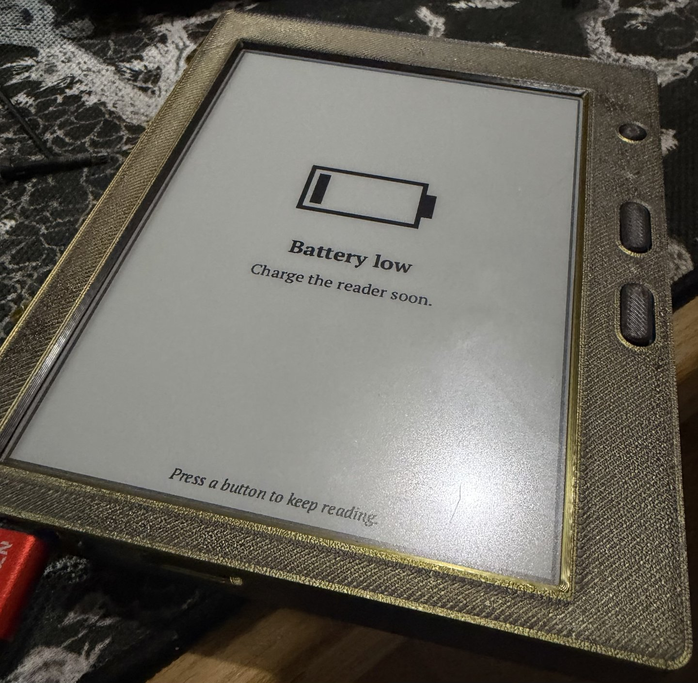

+++
title = "Curiouser and curiouser"
date = 2026-11-01
description = "Slimmer buttons, new screens, and the whole case printed from scrap PLA. It's starting to look like a product."
draft = false

[extra]
theme = "oxide"
project = "oxidized-ink"
backdrop = "slab"
backdrop_label = "The outline of an e-reader drawn in glowing characters, turning slowly"
+++

With my neurobiology exam behind me, I was able to do a thing or five for this project. I slimmed down the buttons, added new screens, and finally printed the full case out of scrap PLA.

It has a long way ahead of it, but it does start looking like a product!
