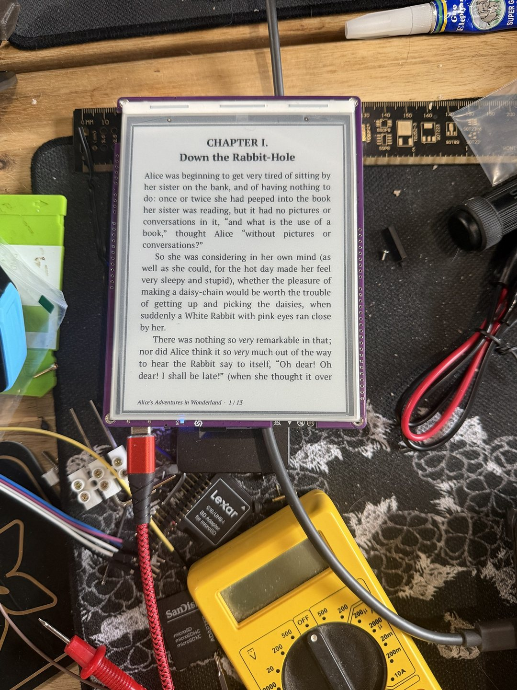

+++
title = "Down the rabbit hole"
date = 2026-10-26
description = "The first chapter on the screen, and the part that still takes forever: testing."
draft = false

[extra]
theme = "oxide"
project = "oxidized-ink"
backdrop = "slab"
backdrop_label = "The outline of an e-reader drawn in glowing characters, turning slowly"
+++

So far, it seems to be coming along nicely. Gathering the hardware information was the hardest part. Thankfully, I got some help from Claude Code.

Testing, as usual, takes a lot of time, even with the simulator. I'll need to see if there is a way to shift that burden to AI as well.
