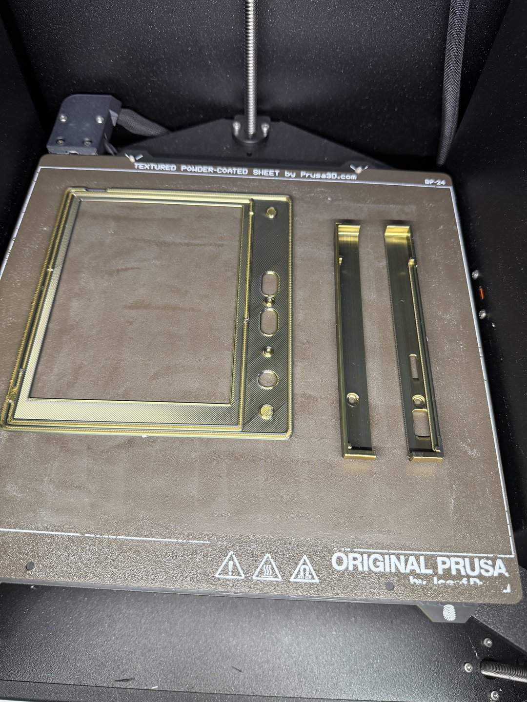

+++
title = "Drink me"
date = 2026-10-28
description = "Fit-test parts for the case, printed from scrap PLA. A little too big, so next it shrinks."
draft = false

[extra]
theme = "oxide"
project = "oxidized-ink"
backdrop = "slab"
backdrop_label = "The outline of an e-reader drawn in glowing characters, turning slowly"
+++

Worked on the case a little and printed the fit-test parts last night from scrap PLA. The case turned out a little too big for my liking, so I'll look for ways to make it smaller.

