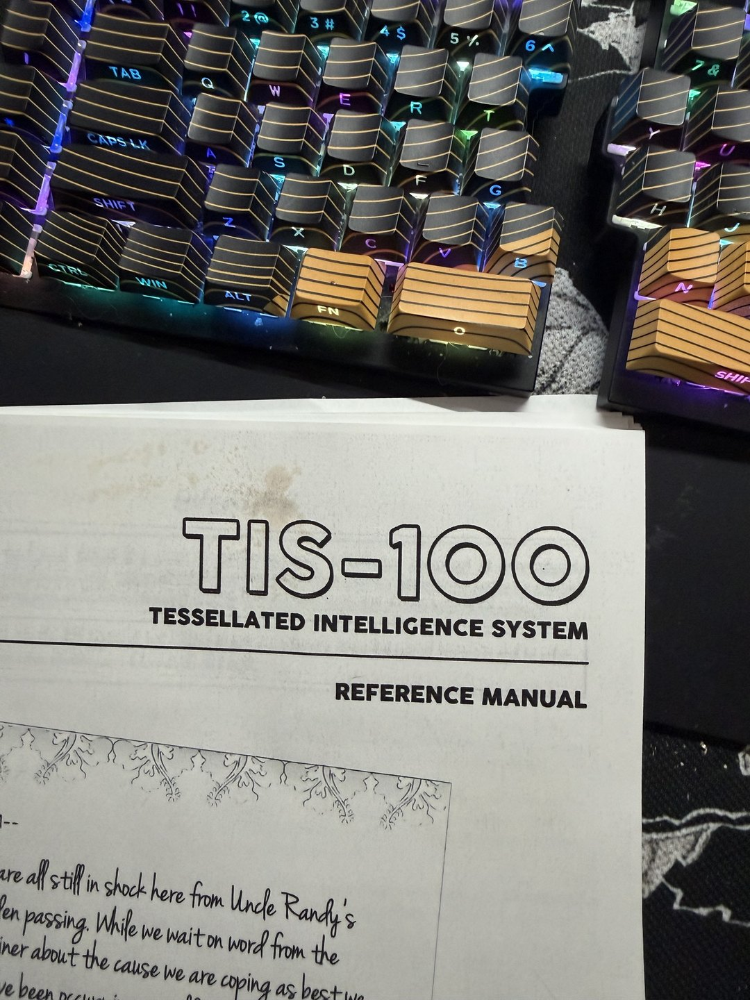

+++
title = "Nothing stops me now"
date = 2026-10-30
description = "An old printout of the TIS-100 manual turned up while cleaning. Time to build one for real."
draft = false

[extra]
theme = "tesser"
project = "tesser-4c7"
backdrop = "tile"
backdrop_label = "A single Tesser-4C7 tile drawn in glowing characters, turning slowly: a square block with its screen on the front and the halo lit round its sides"
+++

I was cleaning up today, and found this old thing.. I spent ample time with good old Zachtronics TIS-100. I always wanted to build one in real world, and I guess nothing stops me from doing that now.

We'll call it Tesser-4C7. I thought about TIS-200.. or even TIS-2000, but that's Zach's property, so – let's settle on Tesser.

A grid of small computers – a Pi Pico and a 2" screen in every node, running a few lines of assembly and passing data to neighbors. Snap a few together, and they become one machine.
