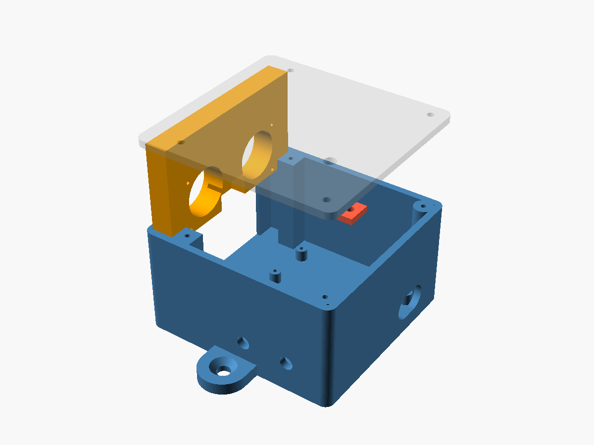
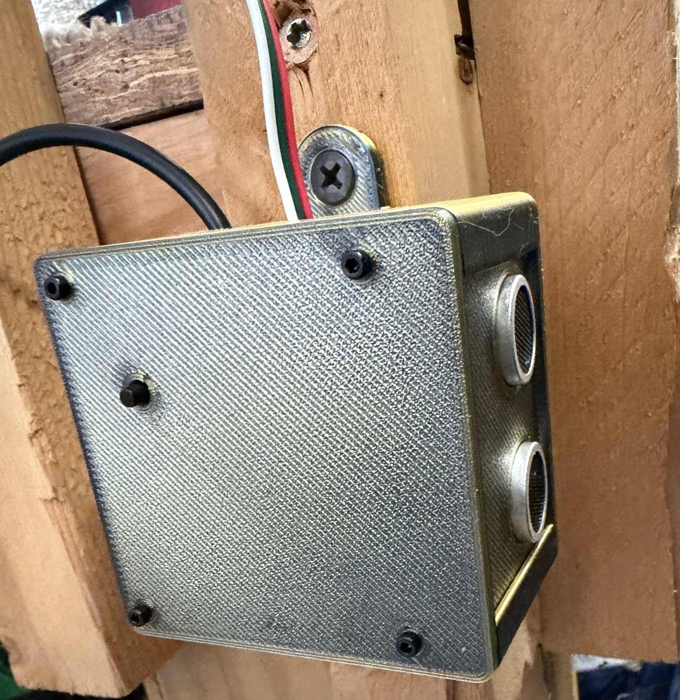
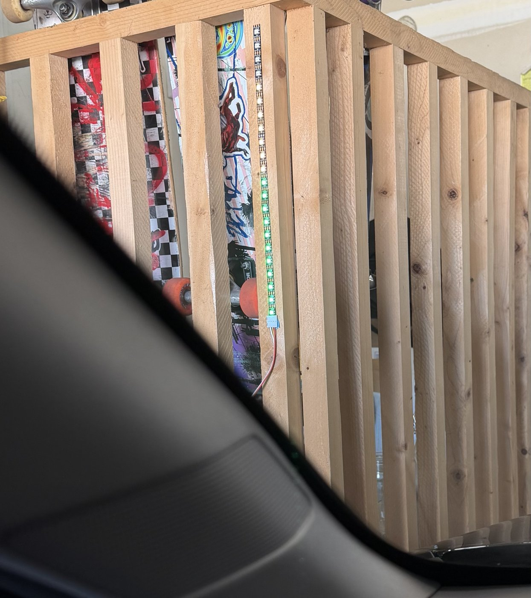

+++
title = "One white dot"
date = 2026-11-15
description = "A parking light for a tight garage: an ultrasonic sensor, a strip of LEDs on the beam, and the firmware in Rust, eventually."
draft = false

[extra]
theme = "bench"
project = "small-builds"
backdrop = "strip"
backdrop_label = "A strip of LEDs drawn in glowing characters, swinging slowly while its lights fill green, amber and red, blink red, then go dark"
+++

The parking sensor in my Ioniq 6 doesn't have enough resolution for me to park in peace avoiding the stairs in my garage. It just paints a red sector on the screen and starts screaming at me.

So I built a parking light. An HC-SR04 ultrasonic sensor watches the side of the car, and a strip of LEDs on the beam fills green, then amber, then red as I get closer. When I've gone too far, the whole strip blinks red. It goes dark on its own once the car stops moving.

The parts: an Arduino Nano (I have a bunch of HiLetgo clones from other projects), the HC-SR04, a strip of WS2812Bs, a tactile button, and a 3D-printed box that holds the sensor in its side, so it looks straight at the car.

And because it can't be that hard, the firmware is in Rust. 🤭

## One white dot

The first flash gave me a single white dot. The second gave me two. 

Three classical blunders:

- **The strip.** A plain Arduino rainbow, with timing known to work, lit two LEDs and nothing after them. Two bad LEDs at the start of the strip; I cut them off, and it's 22 LEDs now.
- **The gaps.** The Rust crate drives the LEDs through SPI, four SPI bits for every LED bit. Sent a byte at a time, the Nano left gaps long enough for the LEDs to take as "end of frame". Rendering the whole frame into a buffer first and sending it in one go fixed that.
- **The big white.** Every 0 bit was being read as a 1. At 2 MHz a 0 stays high for 500 ns, which this strip calls a 1; at 4 MHz it's 250 ns. And in SPI mode 0, the AVR puts the first bit of every byte on the wire half a clock early, so that bit ran long too. Mode 1 fixed it.

## The button that was always pressed

With everything soldered, the button did the opposite of what it should: pressing it turned the strip off. The serial log told the story. Two seconds after every boot, the Nano set a new limit on its own, then ignored the button for good, and every press showed up as a run of "nothing there".

D2 (the button) and D3 (the sensor's trigger) sit side by side, and a tiny solder bridge joined them. The trigger pin is low almost all the time, so the button read as held from power-on, and pressing it grounded the trigger, so the sensor went quiet. One swipe of the iron, and the button works.

## Parked

Park where you want to stop, hold the button for two seconds, three blue flashes, done.

The Rust and Arduino firmware and the printable box are on GitHub: [github.com/kazaiev/garage-parking](https://github.com/kazaiev/garage-parking).
