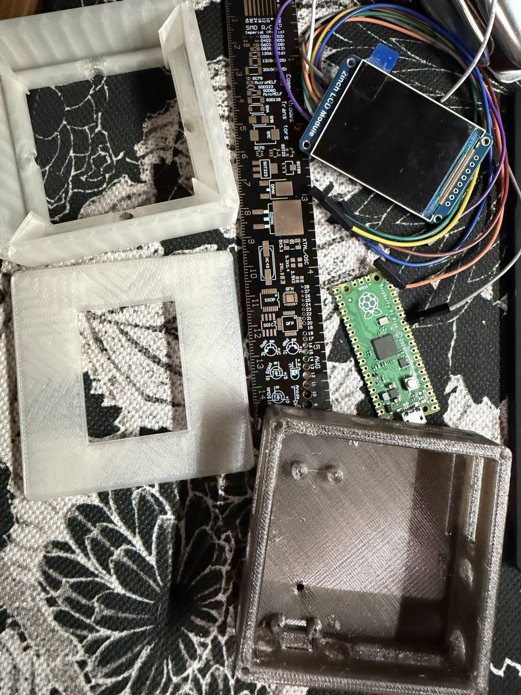
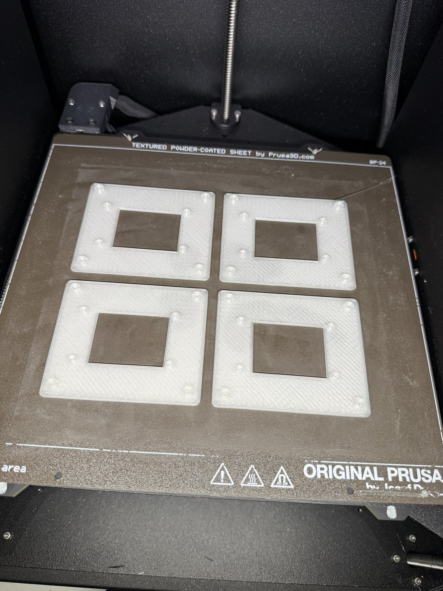
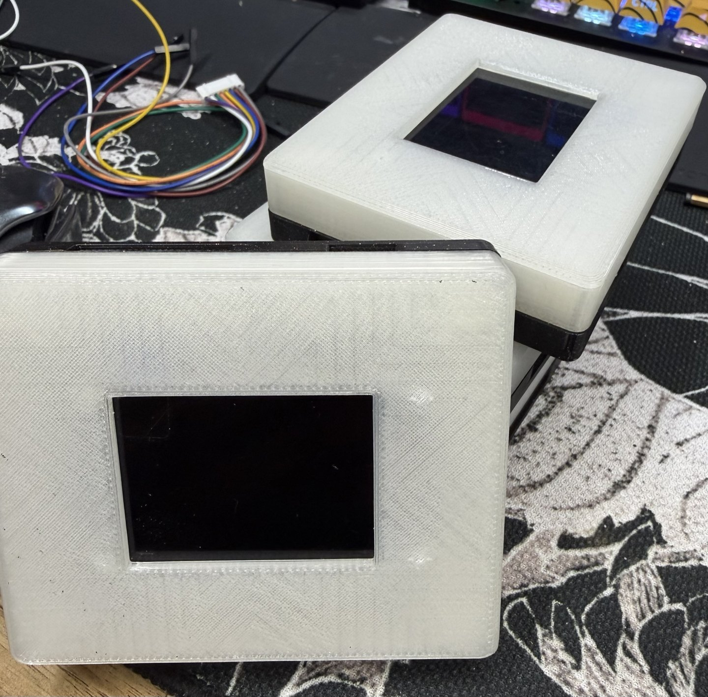
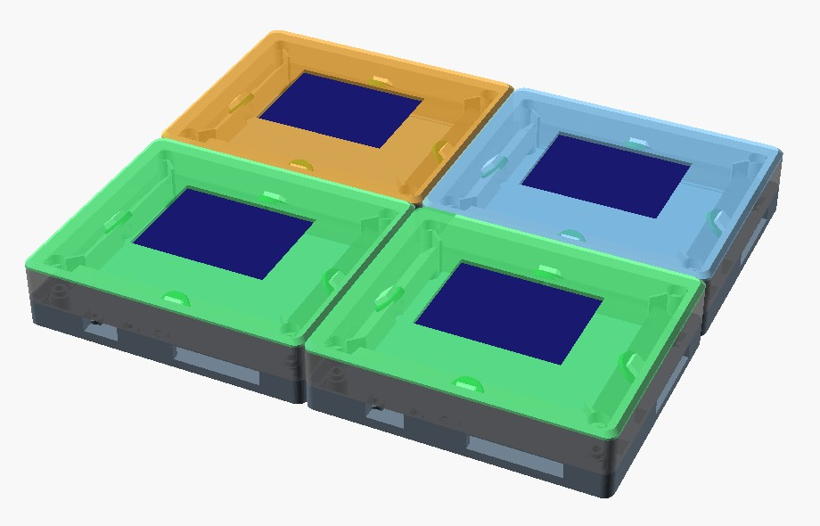
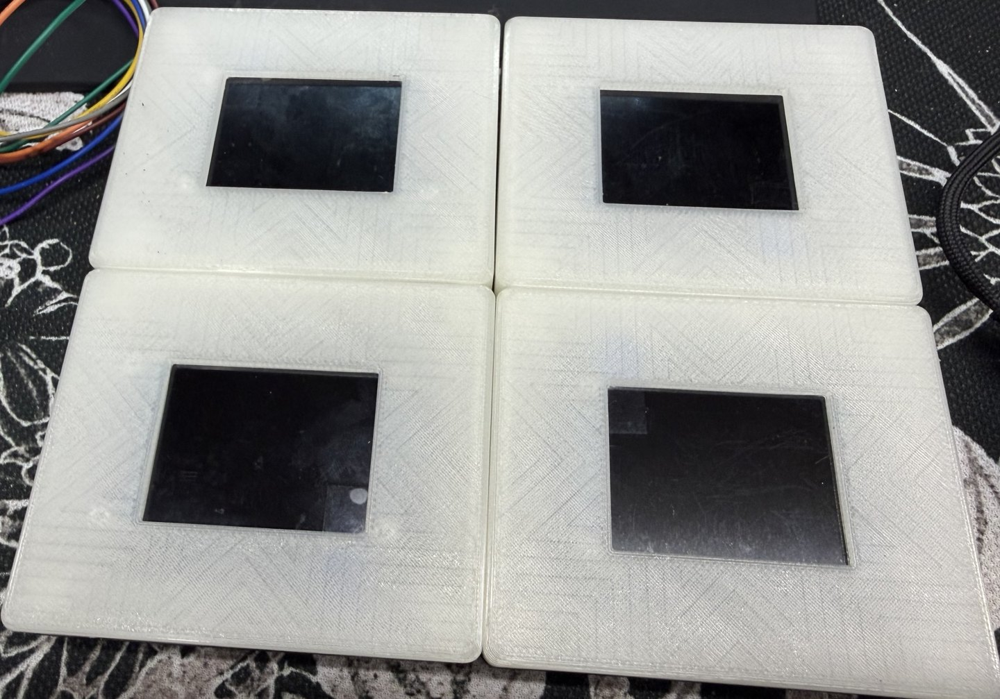

+++
title = "The plastic arrives"
date = 2026-11-02
description = "From a tall square box to four tiles on the desk: the first test prints for Tesser-4C7."
draft = false

[extra]
theme = "tesser"
project = "tesser-4c7"
backdrop = "tile"
backdrop_label = "The outline of a Tesser tile drawn in glowing characters, turning slowly"
+++

The test prints are in. It started tall and square:

Then came the lids, four at a time:

And then the tiles themselves, white and black:

A tile is three slices. The dark shell at the bottom holds the Pico. The lid on top has a window for the screen. The halo in between is the fun part: its LEDs sit on a 45° slope that points their light at the seam, so when a value crosses from one tile to the next, the edge between them should flash.

Here is how it looked on screen before any of it was printed:

And here it is on my desk today:

The lid is held on by M2 screws from below, into brass heat-set inserts. The tiles hold each other with 12 × 5 × 3 mm bar magnets in their walls. The screws are stainless 304, which a magnet barely notices, so they don't steal the magnets' pull. I needed expert screw advice for that one.

The magnets came today, and they're a perfect fit. Still waiting on the inserts, the bolts and the Picos: a pack of RP2040 clones with USB-C.

Next: the inserts and the edge pins, then light in the halo.
